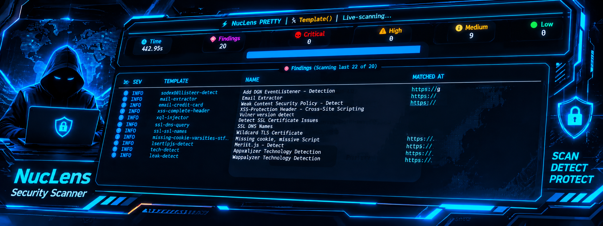

  

<!DOCTYPE html>
<html lang="id">
<head>
  <meta charset="UTF-8">
  <meta name="viewport" content="width=device-width, initial-scale=1.0">
  <title>Nuclens | Website Scanner</title>
  
</head>
<body>
<main class="wrap">
  <header class="hero">
NUCLENS

Website Security Scanner
SCAN • DETECT • REPORT</header>
  <section class="card"><h2>🔎 Tentang Nuclens</h2>
<strong>Nuclens</strong> adalah alat pemindai website untuk membantu memeriksa dan menemukan indikasi masalah keamanan pada website. Nuclens memiliki konsep penggunaan yang mirip dengan Nuclei dan dibuat oleh <strong>Mr Panglima Jatim</strong>.
</section>
  <section class="card"><h2>⚙️ Instalasi Modul</h2>
Jalankan perintah berikut pada Kali Linux atau Debian:

    <pre><button class="copy" onclick="copyCode(this)">Salin</button><code>sudo apt update
sudo apt install python3-pycryptodome python3-full python3-venv -y</code></pre>
    
Masuk ke folder Nuclens, buat virtual environment, lalu aktifkan:

    <pre><button class="copy" onclick="copyCode(this)">Salin</button><code>cd /home/kali/x3-env
python3 -m venv venv
source venv/bin/activate</code></pre>
    
Install modul Python yang dibutuhkan:

    <pre><button class="copy" onclick="copyCode(this)">Salin</button><code>pip install pycryptodome
pip install rich</code></pre>
  </section>
  <section class="card"><h2>🚀 Cara Menjalankan</h2>
Jalankan Nuclens dengan memasukkan URL website target:

    <pre><button class="copy" onclick="copyCode(this)">Salin</button><code>python Nuclens.py -u https://contoh.com</code></pre>
    
Ganti <code>https://contoh.com</code> dengan URL website yang kamu miliki atau yang sudah memberikan izin untuk diuji.

  </section>
  <section class="card"><h2>📄 Hasil Scanning</h2>
Hasil pemindaian akan disimpan otomatis ke file <code>Nuclens.txt</code> di folder kerja program.
</section>
  <section class="card"><h2>⭐ Dukung Pengembangan</h2>
Jika Nuclens bermanfaat, jangan lupa berikan ⭐ STAR pada repository ini dan dukung channel YouTube <strong>Panglima Jatim</strong>.

▶️ <a href="https://www.youtube.com/results?search_query=Panglima+Jatim" target="_blank" rel="noopener noreferrer">Cari dan subscribe Panglima Jatim di YouTube</a>
</section>
  <footer class="footer">
Developed by <strong>Mr Panglima Jatim</strong>

NUCLENS — Scan responsibly.
</footer>
</main>

</body>
</html>

